# 摘要

本作品完成了一个面向高校教学场景的**学生信息管理系统**，覆盖数据库从概念设计、逻辑设计、物理设计、数据库实施到应用程序开发、运行演示的完整流程。系统采用 Qt 6.11（C++17）构建桌面客户端，使用 SQLite 3.51 作为嵌入式关系数据库，通过统一的 `StudentSystem.db` 管理用户、教师、班级、学生、课程、成绩与审计日志。

系统设置管理员、教师、学生三类角色：管理员负责教师账号、数据看板、审计日志与备份恢复；教师负责学生、班级、课程、成绩与统计报表；学生只能查看本人的信息、成绩、GPA 与排名。数据库层实现了外键与级联策略、CHECK 约束、唯一约束、索引、视图、触发器、事务、会话审计、WAL 并发控制和一致性备份恢复；应用层使用预处理语句、统一口令哈希、输入校验与异常处理，修复了原 1.0 版本中教师编号冲突、外键未启用、成绩孤儿记录、班级信息丢失、明文密保答案等一系列问题。

测试结果表明：数据库脚本的 36 项约束/触发器/视图断言全部通过，应用程序自检的 43 项断言全部通过；在 20 万条成绩、5 万条审计日志的测试数据上，显式索引使典型查询耗时降低 4.1～545.8 倍。本作品形成了可执行程序、完整 SQL 脚本、自动化测试、16 张运行截图和本说明书，可直接用于课程演示与答辩。

**关键词**：学生信息管理系统；SQLite；Qt；数据库设计；E-R 模型；触发器；索引优化；事务

<!-- toc -->

# 第1章 选题背景与意义

## 1.1 选题背景

随着高校招生规模扩大和学分制管理的普及，学生、班级、课程、成绩等教学数据量持续增长。传统依靠纸质表格或零散 Excel 文件的管理方式存在明显不足：同一学生的信息被多个文件重复记录，数据一致性难以保证；成绩统计需要人工汇总，效率低且容易出错；教师、管理员之间的数据无法共享；历史修改缺少审计记录；数据备份依赖手工复制，存在丢失风险。

数据库技术正是解决上述问题的核心手段。一个设计良好的关系数据库可以把学生管理中的实体与联系抽象为规范的表结构，通过主键、外键、唯一约束、CHECK 约束和触发器保证数据完整性，通过索引和视图提高查询与统计效率，通过事务和备份恢复保证可靠性。因此，选择“学生信息管理系统”作为数据库应用程序设计与开发的题目，既能覆盖数据库课程的主要知识点，又具有明确的现实意义。

本作品在原有 Qt 版“教师管理系统 1.0”的基础上进行重构与增强。原版本虽然实现了基本的学生、课程、成绩录入功能，但采用“每位教师一个独立数据库文件”的结构，无法进行全校范围的统计；数据库层没有启用外键，没有索引、视图、触发器和事务；密码仅做一次无盐 SHA-256，密保答案以明文保存；同时存在教师编号冲突、编辑学生后班级被重置、删除学生留下孤儿成绩、空班级无法保存等缺陷。本作品保留原有窗口交互风格，对数据库层和应用层进行了系统性重构，并在报告中对这些问题逐项说明。

## 1.2 项目意义

（1）**教学数据的统一管理**。将学生、班级、课程、成绩、教师账号集中到一个数据库中，消除重复与不一致，支持跨班级、跨课程、跨学期的查询与统计。

（2）**完整覆盖数据库课程知识点**。作品包含需求分析、E-R 设计、关系模式与范式分析、完整性约束、索引、视图、触发器、事务、并发控制、安全设计、备份恢复和性能测试，是一次完整的数据库工程实践。

（3）**工程能力的综合训练**。使用 Qt/C++ 完成三层架构的桌面应用，涉及连接管理、SQL 脚本执行、预处理语句、异常处理、界面主题、自动化截图与自动化测试，锻炼了软件工程与调试能力。

（4）**可扩展的实践基础**。系统采用标准 SQL 与分层结构，后续可迁移到 MySQL/PostgreSQL，或扩展为 Web 版本、增加选课、考勤、奖学金等模块。

## 1.3 开发目标

- 建立一个规范的单库关系模式，满足第三范式，具备完整的实体完整性、参照完整性和用户定义完整性。
- 实现管理员、教师、学生三类角色的登录、鉴权与功能隔离。
- 实现学生、班级、课程、成绩的增删改查，以及 GPA、班级排名、单科排名等统计报表。
- 使用视图、触发器、事务、索引等数据库对象提升可维护性与性能。
- 提供审计日志、数据库备份与恢复、演示数据、自动化测试与部署包。
- 撰写结构完整、数据真实、图文并茂的作品说明书。

# 第2章 需求分析

## 2.1 用户角色与权限

系统设置三类角色，权限划分见表 2-1。角色信息保存在 `users.user_type` 字段中，由数据库 CHECK 约束限定为 `admin`、`teacher`、`student`；登录成功后由主程序根据角色打开不同窗口，各窗口的查询也按角色进行限制（例如教师只能维护本人课程的成绩）。

表 2-1 角色与权限

| 角色 | 主要权限 | 数据范围 | 限制 |
|---|---|---|---|
| 管理员 admin | 教师账号增删、数据看板、审计日志、备份恢复、修改本人密码/密保 | 全部教师账号、统计与审计数据 | 不能删除最后一个管理员；不能直接修改教师课程 |
| 教师 teacher | 学生增删改查、班级管理、本人课程管理、成绩录入与维护、统计报表、开通学生账号 | 全校学生与班级；本人课程及成绩 | 只能编辑本人课程；成绩只能录入本人课程 |
| 学生 student | 查看个人信息、成绩明细、GPA、班级/年级排名、修改密码与密保 | 仅本人数据 | 全部只读，不能修改成绩 |

## 2.2 功能需求

系统功能需求见表 2-2，功能模块划分见图 2-1。

表 2-2 功能需求

| 编号 | 功能 | 说明 |
|---|---|---|
| F01 | 用户登录 | 账号+密码登录，失败次数限制，按角色分流 |
| F02 | 教师注册 | 首次部署时注册管理员；管理员可新增教师；密码强度与密保校验 |
| F03 | 找回密码 | 通过密保问题重置密码，答案加盐哈希校验 |
| F04 | 修改密码 | 校验原密码、确认密码与强度，首次登录强制修改 |
| F05 | 修改密保 | 校验当前密码后更新两个密保问题与答案 |
| F06 | 学生管理 | 学生信息增删改查、分页、按字段搜索、开通学生账号 |
| F07 | 班级管理 | 新增空班级、重命名、删除（学生转为未分班） |
| F08 | 课程管理 | 本人课程增删改，学分校验，课程名教师内唯一 |
| F09 | 成绩管理 | 成绩录入、覆盖确认、修改、删除、按班级/课程/学期筛选 |
| F10 | 统计报表 | 班级绩点排名、全部学生排名、单科班级/全体排名，导出 CSV、打印 |
| F11 | 数据看板 | 学生/教师/班级/课程/成绩计数、班级平均分、分数段分布 |
| F12 | 审计日志 | 查看成绩插入/修改/删除的操作者、旧值、新值、时间 |
| F13 | 备份恢复 | 单文件一致性备份、备份校验、恢复前安全副本、失败回滚 |
| F14 | 学生端 | 查看个人信息、成绩、GPA、排名，按学期筛选 |
| F15 | 演示与自检 | 首次运行写入演示数据；`--self-test` 自动化测试；`--capture` 截图 |

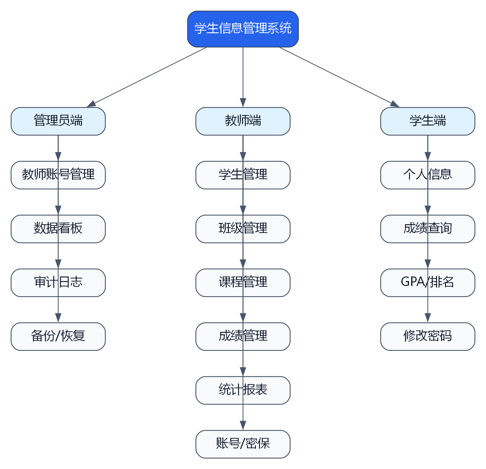

## 2.3 业务流程分析

### 2.3.1 登录与鉴权流程

用户输入账号与密码后，系统在 `users` 表中按用户名查找记录，使用该用户的随机盐和 10000 轮迭代哈希校验密码；校验通过后检查账号是否启用、是否首次登录需要改密，再依据 `user_type` 打开管理员、教师或学生窗口。连续 5 次失败后，登录按钮锁定 30 秒。流程见图 2-2。

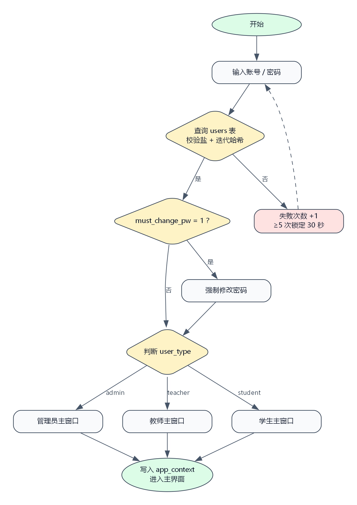

### 2.3.2 成绩录入流程

教师选择学生、本人课程与学期，系统在界面层和数据库层同时校验成绩是否在 0～100 之间、学期是否符合 `2024-2025-1` 格式。若同一学生、课程、学期已有成绩，系统提示是否覆盖，确认后使用 `INSERT ... ON CONFLICT ... DO UPDATE`（UPSERT）写入；触发器自动把旧值、新值、操作者和时间写入 `audit_log`。流程见图 2-3。

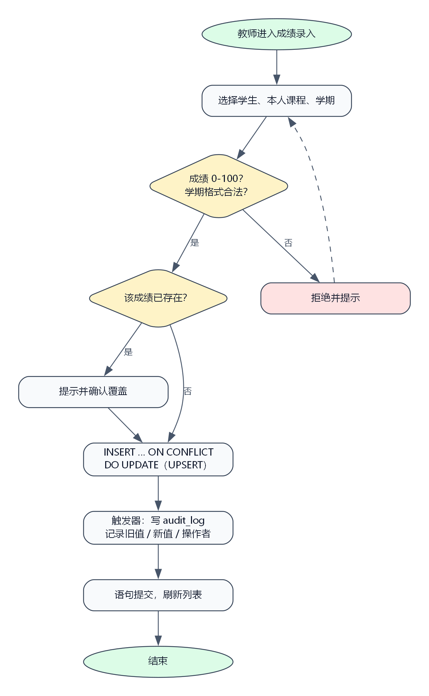

### 2.3.3 备份与恢复流程

备份使用 SQLite 的 `VACUUM INTO` 生成一致性快照，避免直接复制正在写入的数据库文件。恢复时先以只读方式校验备份的 `integrity_check`、核心表和 `schema_meta` 版本；通过后为当前数据库创建 `.bak` 安全副本，关闭连接、替换文件、重新打开并执行完整性与外键检查；任一步失败自动回滚到安全副本。

## 2.4 数据需求与数据字典

系统共设计 9 张表：`users`、`teachers`、`classes`、`students`、`subjects`、`grades`、`audit_log`、`app_context`、`schema_meta`。其中前 7 张为业务表；`app_context` 为单行会话表，用于向触发器提供当前操作者；`schema_meta` 记录模式与种子数据版本。数据字典见表 2-3 至表 2-9。

表 2-3 用户表 users

| 字段 | 类型 | 约束 | 说明 |
|---|---|---|---|
| user_id | TEXT | 主键 | 账号内部编号，如 admin_001、teacher_001、stu_2024001 |
| username | TEXT | 非空、唯一、NOCASE | 登录名 |
| password_hash | TEXT | 非空 | `sha256i$10000$...` 格式的迭代哈希 |
| password_salt | TEXT | 非空 | 密码独立随机盐 |
| user_type | TEXT | CHECK(admin/teacher/student) | 角色，部分唯一索引保证只有一个管理员 |
| question1 / question2 | TEXT | 非空 | 两个密保问题 |
| answer1_hash / answer1_salt | TEXT | 非空 | 密保答案 1 的哈希与独立盐 |
| answer2_hash / answer2_salt | TEXT | 非空 | 密保答案 2 的哈希与独立盐 |
| is_active | INTEGER | CHECK(0/1) | 账号是否启用 |
| must_change_pw | INTEGER | CHECK(0/1) | 是否首次登录强制改密 |
| created_time | TEXT | 默认当前时间 | 创建时间 |
| last_login_at | TEXT | 可空 | 最近登录时间 |

表 2-4 教师表 teachers

| 字段 | 类型 | 约束 | 说明 |
|---|---|---|---|
| teacher_id | TEXT | 主键、外键→users.user_id、级联删除 | 教师工号 |
| name | TEXT | 非空 | 教师姓名 |
| title | TEXT | 可空 | 职称 |
| phone | TEXT | 可空 | 电话 |
| department | TEXT | 可空 | 所属院系 |
| created_time | TEXT | 默认当前时间 | 建档时间 |

表 2-5 班级表 classes

| 字段 | 类型 | 约束 | 说明 |
|---|---|---|---|
| class_name | TEXT | 主键 | 班级名称（自然键） |
| grade_year | INTEGER | CHECK(2000-2100) | 年级 |
| advisor | TEXT | 可空 | 班主任 |
| created_time | TEXT | 默认当前时间 | 创建时间 |

表 2-6 学生表 students

| 字段 | 类型 | 约束 | 说明 |
|---|---|---|---|
| student_id | TEXT | 主键 | 学号 |
| name | TEXT | 非空 | 姓名 |
| gender | TEXT | CHECK(男/女/其他) | 性别 |
| age | INTEGER | CHECK(5-100) | 年龄 |
| class_name | TEXT | 外键→classes、更新级联、删除置空 | 所属班级，未分班为 NULL |
| phone | TEXT | 可空 | 电话 |
| address | TEXT | 可空 | 地址 |
| status | TEXT | CHECK(在读/休学/毕业/退学) | 学籍状态 |
| user_id | TEXT | 唯一、外键→users、删除置空 | 关联的学生账号 |
| created_time | TEXT | 默认当前时间 | 入学建档时间 |
| updated_at | TEXT | 触发器维护 | 最近更新时间 |

表 2-7 课程表 subjects

| 字段 | 类型 | 约束 | 说明 |
|---|---|---|---|
| subject_id | TEXT | 主键 | 课程编号 |
| subject_name | TEXT | 非空 | 课程名称 |
| credit | REAL | CHECK(0<credit≤20) | 学分 |
| teacher_id | TEXT | 外键→teachers、删除置空 | 任课教师 |
| description | TEXT | 可空 | 课程简介 |
| created_time | TEXT | 默认当前时间 | 创建时间 |
| — | — | UNIQUE(teacher_id, subject_name) | 同一教师课程名唯一 |

表 2-8 成绩表 grades

| 字段 | 类型 | 约束 | 说明 |
|---|---|---|---|
| id | INTEGER | 主键、自增 | 成绩记录编号 |
| student_id | TEXT | 非空、外键→students、更新/删除级联 | 学号 |
| subject_id | TEXT | 非空、外键→subjects、更新级联、删除 RESTRICT | 课程编号 |
| semester | TEXT | 非空、GLOB 检查 | 学期，如 2024-2025-1 |
| score | REAL | 非空、CHECK(0-100) | 成绩 |
| exam_date | TEXT | 可空 | 考试日期 |
| entered_by | TEXT | 外键→teachers、删除置空 | 录入教师 |
| remark | TEXT | 可空 | 备注 |
| created_time / updated_at | TEXT | 默认/触发器 | 创建与更新时间 |
| — | — | UNIQUE(student_id, subject_id, semester) | 同一学生同一课程同一学期唯一 |

表 2-9 审计日志表 audit_log

| 字段 | 类型 | 约束 | 说明 |
|---|---|---|---|
| id | INTEGER | 主键、自增 | 日志编号 |
| table_name | TEXT | 非空 | 被操作的表 |
| operation | TEXT | CHECK(INSERT/UPDATE/DELETE) | 操作类型 |
| record_key | TEXT | 可空 | 业务键，如 学号/课程/学期 |
| old_value | TEXT | 可空 | 旧值 JSON |
| new_value | TEXT | 可空 | 新值 JSON |
| operator | TEXT | 非空 | 操作者 user_id，取自 app_context |
| log_time | TEXT | 默认当前时间 | 操作时间 |

此外，`app_context(id, current_user)` 为单行会话表，登录成功后写入当前用户，供触发器记录操作者；`schema_meta(id, version, applied_time, seed_version, legacy_import_done)` 记录模式版本、种子版本与遗留数据迁移标志，便于后续升级。

## 2.5 非功能需求

（1）**性能**：演示数据（480 条成绩）下所有列表查询应在 100ms 内返回；20 万条成绩规模下，按课程、学期、班级的筛选应利用索引，典型查询控制在毫秒级。

（2）**安全性**：密码与密保答案不得明文存储；权限按角色隔离；登录失败次数限制；关键变更写入审计日志；备份文件可完整性校验。

（3）**可靠性**：多步操作使用事务；外键启用并配置合理的级联策略；恢复失败自动回滚；首次运行自动建库并写入演示数据。

（4）**易用性**：全中文界面、统一浅色主题、分页与搜索、输入即时校验、错误信息可读；窗口在 1366×768 及以上分辨率可正常显示。

（5）**可维护性**：数据库脚本独立存放（`sql/schema.sql`、`sql/seed.sql`），应用层按“界面—业务—数据访问”分层；提供自动化测试与自检模式。

# 第3章 数据库设计

## 3.1 概念结构设计

根据需求，系统包含以下实体：用户、教师、班级、学生、课程、成绩（联系实体）与审计日志。主要联系如下：

- **用户—教师（1:1）**：教师账号是用户的一种角色，教师档案通过 `teacher_id` 引用 `users.user_id`。
- **用户—学生（1:1，可选）**：学生可以开通一个登录账号；未开通时 `students.user_id` 为 NULL。
- **班级—学生（1:N）**：一个班级包含多名学生，一名学生至多属于一个班级。
- **教师—课程（1:N）**：一名教师可讲授多门课程，一门课程由一名教师负责。
- **学生—课程（M:N）**：通过“取得成绩”联系实现，联系属性包括学期、分数、考试日期、录入教师；在关系模型中用 `grades` 表表示。
- **成绩—审计日志（1:N）**：成绩的增删改由触发器写入审计日志。

全局 E-R 图见图 3-1。为突出实体与联系，图中省略了非主属性，完整属性见数据字典与关系模式。

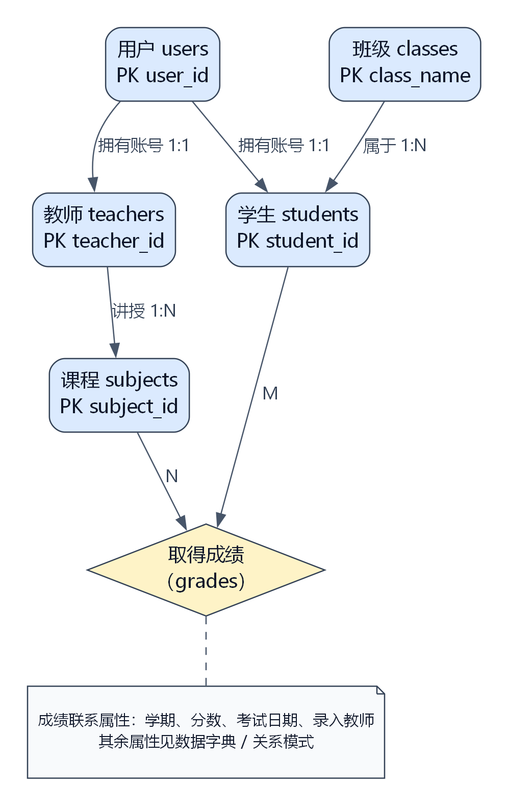

## 3.2 逻辑结构设计

将 E-R 图转换为关系模式，得到：

- `users(user_id, username, password_hash, password_salt, user_type, question1, answer1_hash, answer1_salt, question2, answer2_hash, answer2_salt, is_active, must_change_pw, created_time, last_login_at)`
- `teachers(teacher_id, name, title, phone, department, created_time)`，`teacher_id` 外键引用 `users(user_id)`
- `classes(class_name, grade_year, advisor, created_time)`
- `students(student_id, name, gender, age, class_name, phone, address, status, user_id, created_time, updated_at)`，`class_name` 外键引用 `classes`，`user_id` 外键引用 `users`
- `subjects(subject_id, subject_name, credit, teacher_id, description, created_time)`，`teacher_id` 外键引用 `teachers`，`UNIQUE(teacher_id, subject_name)`
- `grades(id, student_id, subject_id, semester, score, exam_date, entered_by, remark, created_time, updated_at)`，`student_id`、`subject_id`、`entered_by` 为外键，`UNIQUE(student_id, subject_id, semester)`
- `audit_log(id, table_name, operation, record_key, old_value, new_value, operator, log_time)`
- `app_context(id, current_user)`
- `schema_meta(id, version, applied_time, seed_version, legacy_import_done)`

关系模式之间的主外键关系见图 3-2。

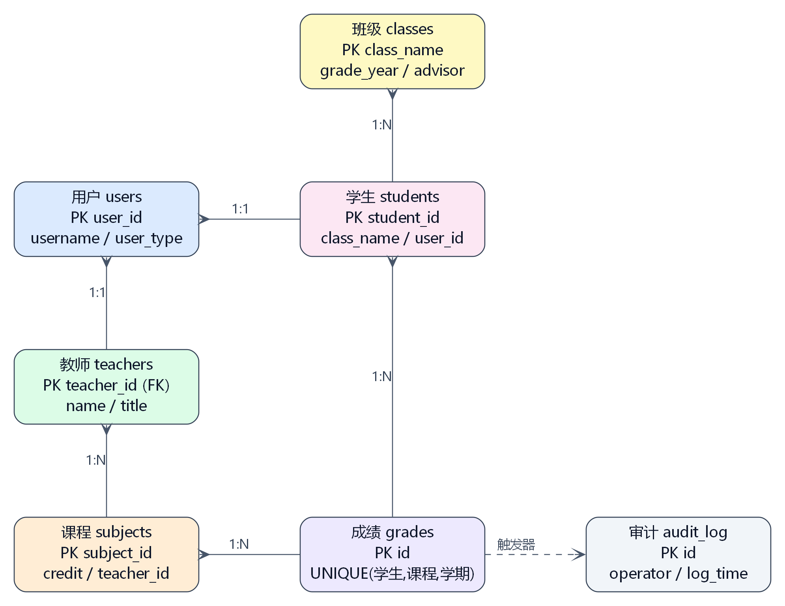

**范式分析**：

（1）所有字段均为原子值，满足第一范式（1NF）。例如密保问题与答案分成两组独立字段，不把多个答案放入一个逗号分隔串。

（2）业务表均使用单列主键（学号、课程号、班级名或自增 id），非主属性完全依赖于主键，满足第二范式（2NF）。`grades` 的业务唯一键为三列组合，但使用自增 `id` 作为主键，三列组合作为唯一约束，避免组合主键带来的引用复杂性。

（3）教师姓名只保存在 `teachers`，班级属性只保存在 `classes`，学生只保存 `class_name` 外键，不存在“学号→班级→班主任”的传递依赖；课程名称、学分只依赖课程编号；成绩的学期、分数只依赖成绩记录。因此满足第三范式（3NF）。`audit_log` 保存的是历史快照（旧值/新值 JSON），属于有意的反规范化设计，用于审计追溯，不参与业务更新。

（4）在 3NF 基础上，除 `grades` 的唯一约束外，各表决定因素均为主键或候选键，基本满足 BCNF。

**设计取舍说明**：

- 采用自然键（学号、课程号、班级名）作为主键，与现有界面的业务字段一致，减少连接与映射成本；学号/课程号变更由 `ON UPDATE CASCADE` 同步到成绩。
- 课程名称采用 `UNIQUE(teacher_id, subject_name)`，允许两位教师各自开设“高等数学”，同时避免同一教师创建重名课程。
- `students.class_name` 允许 NULL，表示“未分班”；删除班级时置 NULL，不产生空字符串脏数据。
- 管理员也存放在 `users` 表中，通过 `user_type` 区分；部分唯一索引 `ux_one_admin` 在数据库层保证最多一个管理员。

## 3.3 物理结构设计

系统使用单文件 SQLite 数据库 `data/StudentSystem.db`，采用 WAL 日志模式。SQLite 以 B 树组织表和索引，页大小使用默认值；主键与唯一约束自动建立索引，业务查询所需索引另行创建。索引设计见表 3-1。

表 3-1 索引设计

| 索引 | 表（列） | 用途 |
|---|---|---|
| ux_one_admin | users(user_type) WHERE user_type='admin' | 部分唯一索引，保证只有一个管理员 |
| idx_users_type | users(user_type) | 按角色筛选教师/学生 |
| idx_teachers_name | teachers(name) | 教师姓名搜索 |
| idx_students_class | students(class_name) | 按班级筛选学生 |
| idx_students_name | students(name) | 按姓名搜索 |
| idx_grades_student_sem | grades(student_id, semester) | 学生成绩单、按学期筛选 |
| idx_grades_subject_sem | grades(subject_id, semester) | 课程成绩统计、单科排名 |
| idx_subjects_teacher | subjects(teacher_id) | 教师课程列表 |
| idx_audit_time | audit_log(log_time) | 审计日志按时间倒序 |
| idx_audit_operator | audit_log(operator) | 按操作者筛选 |

数据库对象统计：9 张表、5 个视图、8 个触发器、15 个显式索引，另有由主键与 UNIQUE 约束自动生成的自动索引。

## 3.4 完整性约束设计

（1）**实体完整性**：所有表均定义主键；`users.username`、`students.student_id`、`subjects.subject_id`、`classes.class_name` 等业务键均唯一且非空。

（2）**参照完整性**：启用 `PRAGMA foreign_keys=ON`，并配置级联策略：
- `grades.student_id` → `students`：`ON UPDATE CASCADE ON DELETE CASCADE`，删除学生自动删除其成绩。
- `grades.subject_id` → `subjects`：`ON UPDATE CASCADE ON DELETE RESTRICT`，存在成绩的课程禁止直接删除；应用层先确认并删除成绩，再删课程，整个过程在事务中完成。
- `students.class_name` → `classes`：`ON UPDATE CASCADE ON DELETE SET NULL`，班级改名自动同步，删除班级后学生变为未分班。
- `teachers.teacher_id` → `users`：`ON DELETE CASCADE`；删除教师账号时级联删除教师档案，课程与成绩的 `teacher_id`/`entered_by` 置 NULL，历史数据保留。
- `students.user_id` → `users`：`ON DELETE SET NULL`，注销账号不影响学籍。

（3）**用户定义完整性**：通过 CHECK 约束限制性别、年龄、成绩、学分、学期格式、角色、状态等；通过触发器提供中文错误提示、审计、更新时间维护和最后管理员保护。

（4）**业务规则**：同一学生同一课程同一学期只允许一条成绩；同一教师课程名唯一；最后一个管理员不能被删除或改成其他角色；未开通账号的学生不能被重复开通。

## 3.5 安全性设计

（1）**口令存储**：密码使用 16 字节随机盐 + 10000 轮 SHA-256 迭代，存储为 `sha256i$10000$<hex>`；两个密保答案分别使用独立盐和相同的迭代哈希。旧版本的 64 位无盐 SHA-256 在首次成功登录时自动升级，兼容历史账号。报告同时指出：生产环境应优先使用 bcrypt、scrypt 或 Argon2 等抗 GPU 的口令哈希算法。

（2）**角色隔离**：登录后按 `user_type` 打开不同窗口；教师端课程维护与成绩维护查询均带 `teacher_id` 条件（班级 GPA 报表按全校口径统计）；学生端只按本人 `student_id` 查询；管理员不能修改教师课程。

（3）**审计**：成绩的 INSERT/UPDATE/DELETE 由触发器写入 `audit_log`，记录操作者、时间、业务键、旧值和新值。`app_context` 表在登录时保存当前用户，使 SQLite 触发器能够记录“谁改的”。

（4）**其他**：登录连续失败 5 次锁定 30 秒；首次登录强制修改初始密码；备份文件恢复前做完整性校验；数据库文件位于程序目录的 `data/`，不可写时回退到用户 AppData 目录。

# 第4章 数据库实施

## 4.1 开发与运行环境

表 4-1 开发与运行环境

| 项目 | 配置 |
|---|---|
| 操作系统 | Windows 11 家庭中文版（10.0.26200） |
| 开发框架 | Qt 6.11.0，Qt Widgets / Qt SQL / Qt Charts / Qt PrintSupport |
| 编译器 | MinGW GCC 13.1.0，C++17 |
| 数据库 | SQLite 3.51.2（Qt QSQLITE 驱动内置） |
| 构建工具 | qmake + mingw32-make |
| 部署工具 | windeployqt |
| 文档与绘图 | python-docx、Graphviz、matplotlib |

## 4.2 建库与建表

数据库初始化由 `DatabaseManager::initializeDatabases()` 完成：解析数据库路径、打开连接、执行 PRAGMA、读取并执行 `sql/schema.sql`、检查 `schema_meta` 版本，若用户表为空则写入演示数据。

连接建立后执行的关键 PRAGMA 如下：

```sql
PRAGMA foreign_keys = ON;
PRAGMA busy_timeout = 5000;
PRAGMA journal_mode = WAL;
PRAGMA synchronous = NORMAL;
```

核心建表示例（完整脚本见附录 A 与 `sql/schema.sql`）：

```sql
CREATE TABLE IF NOT EXISTS students (
    student_id  TEXT PRIMARY KEY,
    name        TEXT NOT NULL,
    gender      TEXT NOT NULL DEFAULT '男' CHECK (gender IN ('男','女','其他')),
    age         INTEGER CHECK (age IS NULL OR (age BETWEEN 5 AND 100)),
    class_name  TEXT REFERENCES classes(class_name)
                ON UPDATE CASCADE ON DELETE SET NULL,
    phone       TEXT,
    address     TEXT,
    status      TEXT NOT NULL DEFAULT '在读'
                CHECK (status IN ('在读','休学','毕业','退学')),
    user_id     TEXT UNIQUE REFERENCES users(user_id)
                ON UPDATE CASCADE ON DELETE SET NULL,
    created_time TEXT NOT NULL DEFAULT (datetime('now','localtime')),
    updated_at  TEXT
);

CREATE TABLE IF NOT EXISTS grades (
    id          INTEGER PRIMARY KEY AUTOINCREMENT,
    student_id  TEXT NOT NULL REFERENCES students(student_id)
                ON UPDATE CASCADE ON DELETE CASCADE,
    subject_id  TEXT NOT NULL REFERENCES subjects(subject_id)
                ON UPDATE CASCADE ON DELETE RESTRICT,
    semester    TEXT NOT NULL CHECK (semester GLOB '[0-9][0-9][0-9][0-9]-[0-9][0-9][0-9][0-9]-[12]'),
    score       REAL NOT NULL CHECK (score >= 0 AND score <= 100),
    exam_date   TEXT,
    entered_by  TEXT REFERENCES teachers(teacher_id)
                ON UPDATE CASCADE ON DELETE SET NULL,
    remark      TEXT,
    created_time TEXT NOT NULL DEFAULT (datetime('now','localtime')),
    updated_at  TEXT,
    UNIQUE (student_id, subject_id, semester)
);
```

建表脚本通过自写的 `SqlScript::split()` 分割后逐条执行。分割器能正确处理字符串、注释以及 `CREATE TRIGGER ... BEGIN ... END;` 内部的分号，保证脚本既可以在应用中执行，也可以直接交给 `sqlite3` 命令行执行。

## 4.3 索引实施

索引在 `schema.sql` 中随表一起创建，部分唯一索引保证管理员唯一：

```sql
CREATE UNIQUE INDEX IF NOT EXISTS ux_one_admin
    ON users(user_type) WHERE user_type = 'admin';
CREATE INDEX IF NOT EXISTS idx_students_class ON students(class_name);
CREATE INDEX IF NOT EXISTS idx_grades_subject_sem ON grades(subject_id, semester);
CREATE INDEX IF NOT EXISTS idx_grades_student_sem ON grades(student_id, semester);
CREATE INDEX IF NOT EXISTS idx_audit_time ON audit_log(log_time);
```

索引效果通过 `EXPLAIN QUERY PLAN` 验证：有索引时出现 `SEARCH ... USING COVERING INDEX`，删除显式索引后退化为扫描唯一约束的自动索引（覆盖索引）或全表扫描，并可能使用临时 B 树排序。

## 4.4 视图实施

系统创建 5 个视图，把常用连接与统计逻辑封装在数据库层，应用层直接查询视图，避免在多个窗口重复写复杂 SQL。

**（1）成绩明细视图 `v_student_grades`**：连接学生、班级、课程、教师，计算等级（优秀/良好/中等/及格/不及格）。

```sql
CREATE VIEW IF NOT EXISTS v_student_grades AS
SELECT g.id AS grade_id, s.student_id, s.name AS student_name, s.class_name,
       sub.subject_id, sub.subject_name, sub.credit, g.semester, g.score,
       CASE WHEN g.score >= 90 THEN '优秀'
            WHEN g.score >= 80 THEN '良好'
            WHEN g.score >= 70 THEN '中等'
            WHEN g.score >= 60 THEN '及格'
            ELSE '不及格' END AS grade_level,
       g.exam_date, COALESCE(t.name, '未分配') AS teacher_name
FROM grades g
JOIN students s   ON s.student_id = g.student_id
JOIN subjects sub ON sub.subject_id = g.subject_id
LEFT JOIN teachers t ON t.teacher_id = sub.teacher_id;
```

**（2）班级课程统计视图 `v_class_subject_stats`**：按班级、课程、学期统计人数、平均分、最高分、最低分、及格率和优秀率，用于单科排名与报表。

**（3）学生总览视图 `v_student_overview`**：使用窗口函数 `ROW_NUMBER()` 取每门课程最新一次成绩，按学分计算加权平均分和 GPA，并用 `RANK()` 计算班级排名和年级排名。核心代码如下：

```sql
CREATE VIEW IF NOT EXISTS v_student_overview AS
WITH latest AS (
    SELECT g.*, ROW_NUMBER() OVER (
        PARTITION BY g.student_id, g.subject_id
        ORDER BY g.semester DESC, g.id DESC) AS rn
    FROM grades g
),
calc AS (
    SELECT l.student_id, COUNT(*) AS subject_count,
           SUM(sub.credit) AS total_credit,
           ROUND(SUM(l.score * sub.credit) / SUM(sub.credit), 2) AS weighted_avg,
           ROUND(SUM((CASE WHEN l.score >= 90 THEN 4.0
                           WHEN l.score >= 85 THEN 3.7
                           WHEN l.score >= 82 THEN 3.3
                           WHEN l.score >= 78 THEN 3.0
                           WHEN l.score >= 75 THEN 2.7
                           WHEN l.score >= 72 THEN 2.3
                           WHEN l.score >= 68 THEN 2.0
                           WHEN l.score >= 64 THEN 1.5
                           WHEN l.score >= 60 THEN 1.0
                           ELSE 0.0 END) * sub.credit) / SUM(sub.credit), 3) AS gpa
    FROM latest l JOIN subjects sub ON sub.subject_id = l.subject_id
    WHERE l.rn = 1
    GROUP BY l.student_id
)
SELECT s.student_id, s.name, s.class_name, s.status,
       COALESCE(c.subject_count, 0) AS subject_count,
       COALESCE(c.total_credit, 0)  AS total_credit,
       COALESCE(c.weighted_avg, 0)  AS weighted_avg,
       COALESCE(c.gpa, 0)           AS gpa,
       RANK() OVER (PARTITION BY s.class_name ORDER BY COALESCE(c.gpa, 0) DESC) AS class_rank,
       RANK() OVER (ORDER BY COALESCE(c.gpa, 0) DESC) AS grade_rank
FROM students s LEFT JOIN calc c ON c.student_id = s.student_id;
```

**（4）教师工作量视图 `v_teacher_workload`**：统计教师的课程数、成绩录入数、覆盖学生数和平均分。

**（5）审计日志视图 `v_audit_display`**：把 `operator`（user_id）连接为登录名，便于管理员查看。

## 4.5 触发器实施

系统共 8 个触发器，分为四类。

**（1）成绩合法性校验**：在 INSERT 和 UPDATE 前检查分数与学期格式，提供中文错误信息。

```sql
CREATE TRIGGER IF NOT EXISTS trg_grades_validate_ai
BEFORE INSERT ON grades
BEGIN
    SELECT RAISE(ABORT, '成绩必须在 0 到 100 之间')
    WHERE NEW.score < 0 OR NEW.score > 100;
    SELECT RAISE(ABORT, '学期格式应为 2024-2025-1')
    WHERE NEW.semester NOT GLOB '[0-9][0-9][0-9][0-9]-[0-9][0-9][0-9][0-9]-[12]';
END;
```

**（2）成绩审计**：INSERT、UPDATE、DELETE 三个 AFTER 触发器把操作写入 `audit_log`，使用 `json_object()` 保存旧值和新值，操作者取自 `app_context`。

```sql
CREATE TRIGGER IF NOT EXISTS trg_grades_audit_au
AFTER UPDATE ON grades
BEGIN
    INSERT INTO audit_log(table_name, operation, record_key, old_value, new_value, operator)
    VALUES ('grades', 'UPDATE',
            OLD.student_id || '/' || OLD.subject_id || '/' || OLD.semester,
            json_object('score', OLD.score, 'semester', OLD.semester, 'exam_date', OLD.exam_date),
            json_object('score', NEW.score, 'semester', NEW.semester, 'exam_date', NEW.exam_date),
            COALESCE((SELECT current_user FROM app_context WHERE id = 1), 'system'));
END;
```

**（3）学生更新时间维护**：`trg_students_touch` 在更新学生后自动写入 `updated_at`。

**（4）最后管理员保护**：`trg_last_admin_delete` 与 `trg_last_admin_update` 阻止删除最后一个管理员或把其角色改成教师。

## 4.6 事务与并发控制

系统对多步操作使用事务，保证原子性：

| 场景 | 事务内操作 |
|---|---|
| 注册教师 | 插入 users → 插入 teachers |
| 删除学生 | 删除学生账号 → 删除学生（成绩级联删除） |
| 删除课程 | 删除该课程成绩 → 删除课程（检查教师归属） |
| 删除教师 | 删除 users（级联 teachers；课程/成绩录入人置空） |
| 开通学生账号 | 插入 users → 回写 students.user_id |
| 成绩录入 | UPSERT 一条语句，触发器同步写审计 |
| 恢复数据库 | 校验 → 安全副本 → 替换 → 完整性检查 → 失败回滚 |

并发控制采用 SQLite WAL 模式：读操作不阻塞写操作，写操作之间由数据库锁串行化；`busy_timeout=5000` 避免短暂锁冲突立即失败。桌面单机场景下并发量低，WAL + 超时足以满足需求。

## 4.7 初始化数据

首次启动时，如果 `users` 表为空，应用自动写入演示数据：

- 4 个班级（含一个空班级“数据科学2401”，验证空班级可持久化），30 名学生（其中 2024030 未分班且状态为休学）；
- 8 门课程，分属两位教师；
- 两个学期共 480 条成绩，覆盖及格、不及格、优秀等不同分数段；
- 4 个演示账号：管理员、两位教师、一名学生；
- 演示数据写入后清空种子阶段产生的审计日志，保持审计界面干净。

种子数据由 `tools/gen_seed.py` 以固定随机种子 2026 生成，保证每次构建的数据一致，便于报告截图与测试复现。

## 4.8 备份与恢复实施

备份不使用文件复制，而是执行：

```sql
VACUUM INTO 'D:/backup/student_backup_20261117_143538.db';
```

`VACUUM INTO` 会在一个事务中读取数据库并写出紧凑、一致的单文件快照，即使数据库处于 WAL 模式或有写入进行也不会得到半成品。备份完成后，程序用只读连接执行 `PRAGMA integrity_check`、检查核心表存在性和 `schema_meta` 版本，校验通过才提示成功。

恢复流程为：校验备份 → 关闭连接 → 复制当前库为 `.bak_时间戳` → 删除 `-wal`/`-shm` → 复制备份覆盖 → 重新打开 → `PRAGMA integrity_check` 与 `PRAGMA foreign_key_check`。任一步失败都会把安全副本复制回来并重新打开，避免出现“原库已删、新库不可用”的情况。

## 4.9 性能测试

为验证索引效果，构造 5000 名学生、20 门课程、200000 条成绩和 50000 条审计日志的测试库，在同一份数据上分别保留与删除显式索引，使用 `EXPLAIN QUERY PLAN` 确认执行计划，并对每条查询重复 25 次取中位数。结果见表 4-2 与图 4-1。

表 4-2 索引优化前后查询耗时

| 查询 | 有显式索引（ms） | 删除显式索引（ms） | 提升倍数 |
|---|---:|---:|---:|
| 按课程+学期统计人数 | 0.317 | 10.966 | 34.5× |
| 按课程统计人数 | 0.376 | 11.126 | 29.6× |
| 按班级筛选学生 | 0.083 | 0.338 | 4.1× |
| 审计日志最近 50 条 | 0.092 | 50.161 | 545.8× |

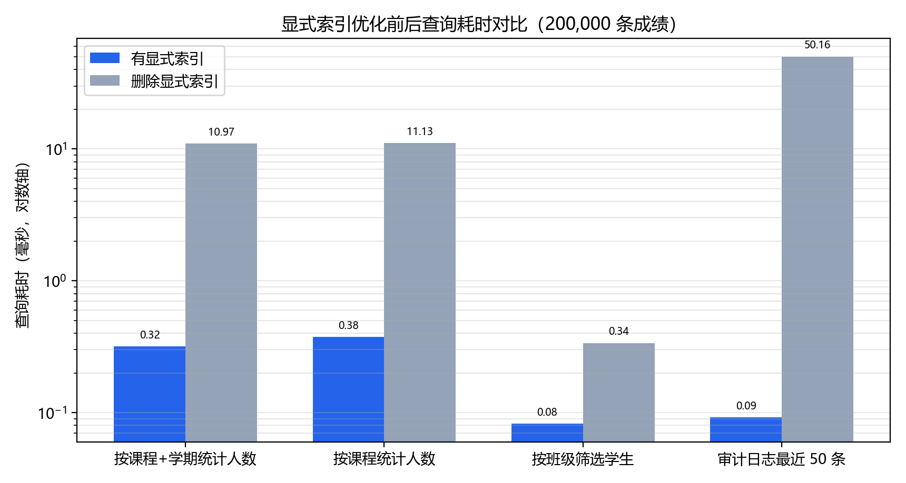

说明：删除显式索引后，按课程查询仍可能使用 `UNIQUE(student_id, subject_id, semester)` 的自动索引做覆盖扫描，因此并非纯粹的全表扫描；但针对性复合索引只读取目标区间，耗时仍低一个数量级。审计日志按时间倒序的查询在无索引时需要全表扫描并建立临时 B 树，差距最大。学生编号查询本身由唯一约束的自动索引覆盖，不需要额外索引，这也说明索引应按查询模式设计，而不是越多越好。

# 第5章 数据库应用开发

## 5.1 系统架构

系统采用三层架构，如图 5-1 所示：

- **表现层**：Qt Widgets 窗口、对话框、菜单、表格、图表与 QSS 主题，负责输入与展示。
- **业务逻辑层**：登录鉴权、学生/班级/课程/成绩管理、统计报表、备份恢复等业务规则。
- **数据访问层**：`DatabaseManager` 单例统一管理连接、PRAGMA、SQL 脚本、预处理语句、事务、备份恢复；`SqlScript` 负责脚本分割；`Validation` 负责统一校验。
- **存储层**：SQLite 数据库文件，包含表、视图、触发器、索引，WAL 日志存放在同目录。

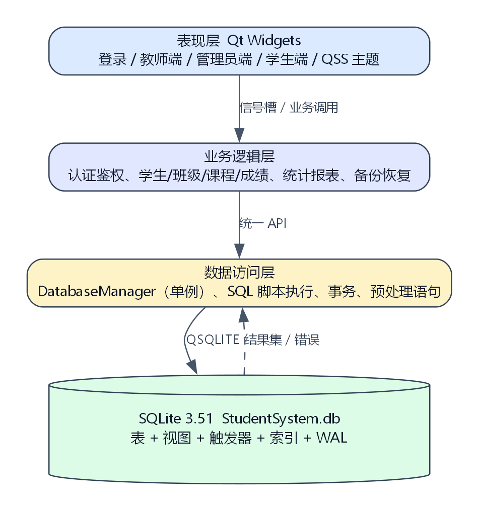

## 5.2 代码组织

表 5-1 主要源码文件

| 文件 | 职责 |
|---|---|
| main.cpp | 程序入口、命令行参数、样式加载、登录分流、首次改密 |
| databasemanager.h/.cpp | 数据库连接、建库、种子数据、认证、哈希、事务、备份恢复 |
| sqlscript.h/.cpp | SQL 脚本分割（引号、注释、触发器 BEGIN…END） |
| validation.h/.cpp | 密码强度、电话、学号、学期、HTML 转义、答案归一化 |
| logindialog / registerdialog / forgotpassworddialog | 登录、注册、找回密码 |
| changepassworddialog / changequestionsdialog | 修改密码、修改密保（均校验原密码） |
| teachermainwindow | 教师端：学生、班级、课程、成绩、报表、搜索、导出、打印 |
| adminmainwindow | 管理员端：教师账号、数据看板、审计日志、备份恢复 |
| studentmainwindow | 学生端：个人信息、GPA/排名、成绩明细 |
| addstudentdialog / editstudentdialog / subjectdialog / gradedialog | 学生、课程、成绩编辑对话框 |
| backupdialog / restoredialog | 单文件备份与校验恢复 |
| statsdialog / auditlogdialog | 数据看板、审计日志 |
| screenshottool / selftest | 自动截图、自动化自检 |
| resources/style.qss | 统一浅色主题 |

## 5.3 关键实现

### 5.3.1 数据库连接与路径

数据库路径优先取环境变量 `SMS_DB_PATH`（测试用），否则取程序目录下的 `data/StudentSystem.db`；若程序目录不可写，则回退到 `%APPDATA%/学生信息管理系统`。这样修复了原版本使用 `QDir::currentPath()` 导致“换一个工作目录就打开新库、看起来丢数据”的问题。

连接建立后统一设置 `foreign_keys=ON`、`busy_timeout=5000`、`journal_mode=WAL`、`synchronous=NORMAL`，并再次查询 `PRAGMA foreign_keys` 确认外键确实开启。

### 5.3.2 口令哈希与旧版升级

```cpp
QString DatabaseManager::hashSecret(const QString &secret,
                                    const QString &salt)
{
    const QByteArray saltBytes = salt.toUtf8();
    QByteArray digest = QCryptographicHash::hash(
        saltBytes + secret.toUtf8(), QCryptographicHash::Sha256);
    for (int i = 1; i < 10000; ++i) {
        digest = QCryptographicHash::hash(
            digest + saltBytes, QCryptographicHash::Sha256);
    }
    return QStringLiteral("sha256i$10000$")
           + QString::fromLatin1(digest.toHex());
}
```

登录时若发现 `password_salt` 为空且哈希为 64 位十六进制，则按旧版一次性 SHA-256 校验，成功后立即生成新盐并升级为新格式；密保答案的旧明文格式以 `plain$` 前缀兼容并在校验成功后升级。密码与两个密保答案使用互不相同的盐，修改密码不会导致密保失效。

### 5.3.3 成绩 UPSERT 与审计

成绩录入使用带冲突处理的 UPSERT，一条语句完成“新增或覆盖”，并与唯一约束、CHECK 约束、触发器配合：

```cpp
query.prepare(QStringLiteral(
    "INSERT INTO grades "
    "(student_id, subject_id, semester, score, exam_date, entered_by) "
    "VALUES (?, ?, ?, ?, ?, ?) "
    "ON CONFLICT(student_id, subject_id, semester) "
    "DO UPDATE SET score = excluded.score, "
    "exam_date = excluded.exam_date, "
    "entered_by = excluded.entered_by, "
    "updated_at = datetime('now','localtime')"));
```

写操作完成后，`trg_grades_audit_ai` 或 `trg_grades_audit_au` 自动把新旧值与操作者写入 `audit_log`，应用层无需额外代码。

### 5.3.4 统计报表

班级绩点排名和全部学生排名直接查询 `v_student_overview`，避免了原版本“总学分按成绩行累加、GPA 未按学分加权”的错误。单科排名查询 `v_student_grades`，并在 SQL 中使用 `RANK() OVER (ORDER BY score DESC)` 计算名次。报表统一使用 `showReportDialog()` 展示，支持导出 CSV（UTF-8 BOM，Excel 打开不乱码）和通过 QPrintSupport 打印。

### 5.3.5 备份与恢复

备份调用 `VACUUM INTO`，恢复先校验再替换，并在替换前保存 `.bak` 安全副本；恢复成功后提示用户重启程序，避免旧窗口继续使用已被替换的连接。原版本中“5 秒后自动重启”的定时器随对话框销毁而失效，本次改为明确提示并提供退出。

### 5.3.6 学生端

学生登录后只能按 `students.user_id` 找到本人记录，查询 `v_student_grades` 展示成绩明细，查询 `v_student_overview` 展示 GPA、加权平均分、总学分、班级排名与年级排名。界面全部只读，没有编辑入口。

## 5.4 异常处理与输入校验

（1）统一校验：`Validation` 提供密码强度、电话、学号、姓名、学期格式校验，避免原版本三处重复的密码强度代码和不一致的手机号规则。

（2）数据库兜底：即使界面校验被绕过，CHECK、UNIQUE、外键、触发器仍会拒绝非法数据；应用捕获 `QSqlError` 并转换为中文提示，例如重复学号、课程重名、成绩越界、存在成绩的课程不能直接删除。

（3）行数检查：所有 UPDATE/DELETE 都检查 `numRowsAffected()`，避免“更新 0 行也提示成功”。

（4）空指针与越界：表格取值前检查 `QTableWidgetItem` 是否存在；课程选择使用 `QMap` 保存 ID，不再用 `split(" - ")[1]` 解析显示文本。

（5）事务回滚：注册、删除、开通账号、恢复等多步操作失败时回滚，避免半完成状态。

## 5.5 界面设计

界面采用统一的浅色主题（`resources/style.qss`）：白色卡片、蓝色主按钮、圆角输入框、斑马纹表格、浅灰表头、细滚动条。所有窗口设置中文标题与状态栏提示；教师端支持分页、按字段搜索、班级筛选和右键菜单；管理员端提供数据看板与审计日志；学生端使用卡片式统计区。教师端与管理员端沿用 1600×900、1200×900 的原布局尺寸，学生端可缩放，整体适合课程演示投影。

# 第6章 系统运行与演示

## 6.1 运行环境与部署

开发构建命令（在项目根目录执行）：

```bat
mkdir build-qt611 && cd build-qt611
D:\Qt\6.11.0\mingw_64\bin\qmake.exe ..\StudentManagementSystem_Qt.pro -spec win32-g++ CONFIG+=release
D:\Qt\Tools\mingw1310_64\bin\mingw32-make.exe -j8
```

部署时复制 Release 可执行文件到 `deploy/`，执行：

```bat
D:\Qt\6.11.0\mingw_64\bin\windeployqt.exe --release --compiler-runtime --no-translations --dir deploy deploy\StudentManagementSystem_Qt.exe
```

`windeployqt` 会复制 Qt6Core/Gui/Widgets/Sql/Charts/PrintSupport、`platforms/qwindows.dll`、`sqldrivers/qsqlite.dll` 与 MinGW 运行库。双击 `deploy/StudentManagementSystem_Qt.exe` 即可运行，首次启动自动创建 `data/StudentSystem.db` 并写入演示数据。

## 6.2 功能演示

### 6.2.1 登录与账号

图 6-1 为登录界面，底部给出演示账号提示；图 6-2 为教师注册界面，包含密码确认、两个密保问题和教师姓名；图 6-3 为忘记密码界面，通过密保问题重置密码。

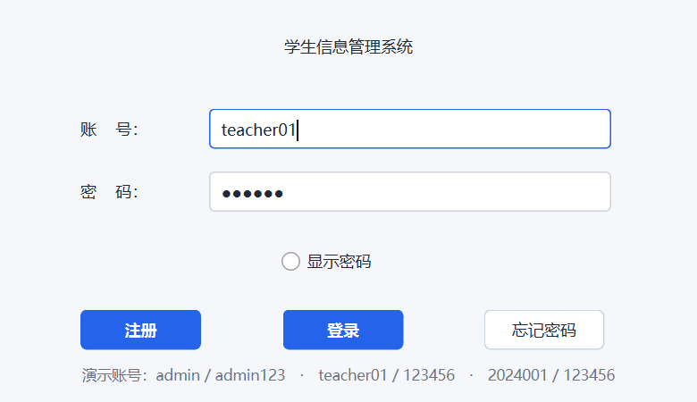

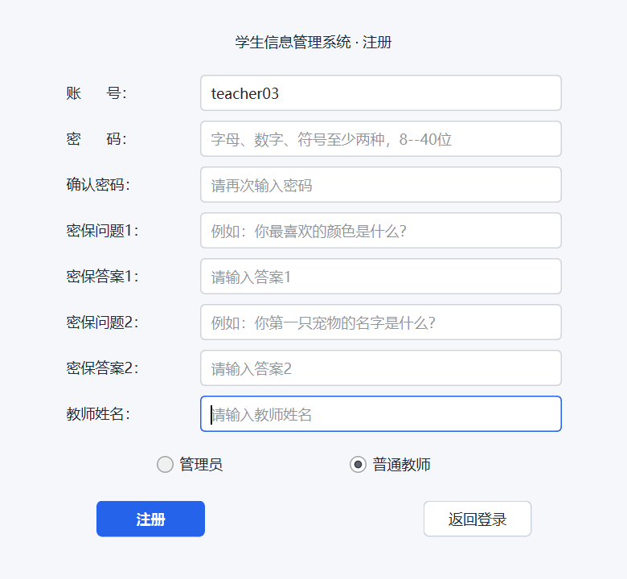

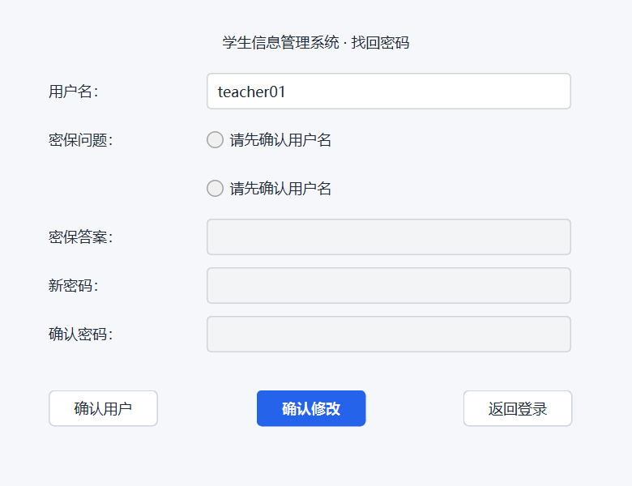

### 6.2.2 教师端

图 6-4 为教师主界面：左侧为班级列表（含空班级“数据科学2401”和“未分班”入口），中间为学生表格，支持分页与按字段搜索；顶部菜单提供学生、课程、成绩、数据操作与账号设置。

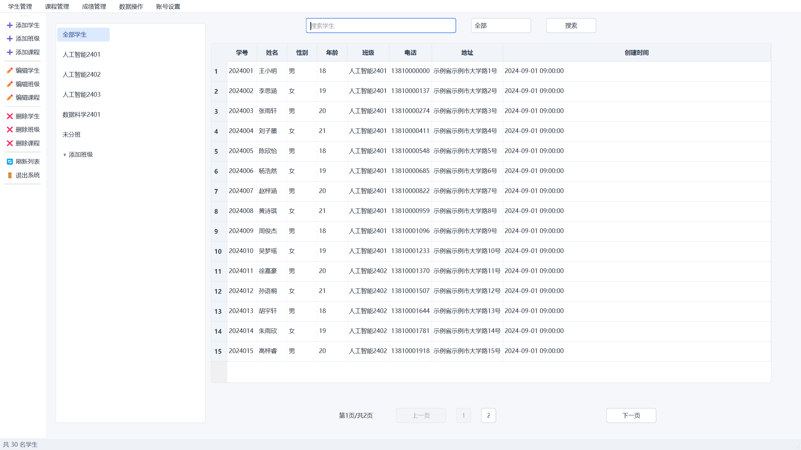

图 6-5、图 6-6 为添加与编辑学生对话框，班级下拉框来自 `classes` 表，编辑时正确预选原班级；图 6-7 为成绩录入，分数上限为 100，学期使用 `2024-2025-1` 规范格式；图 6-8 为课程添加，学分默认 3.0。

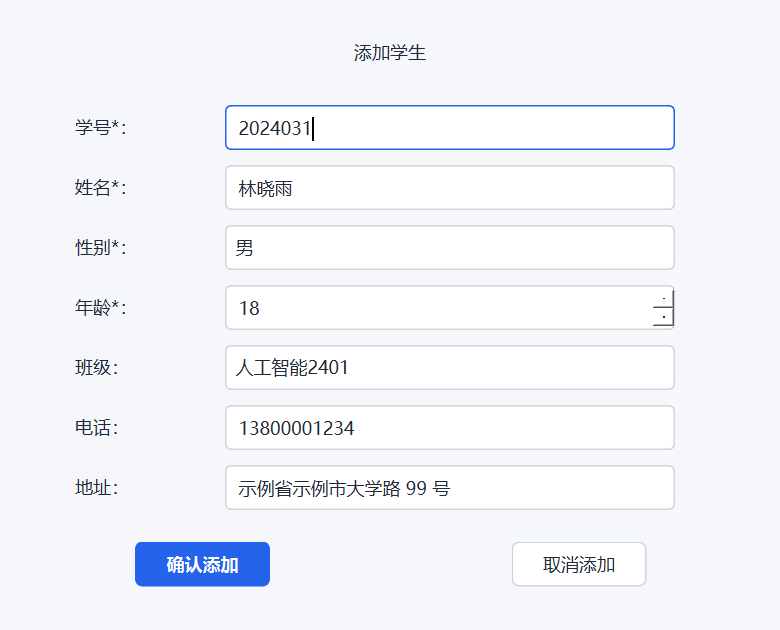


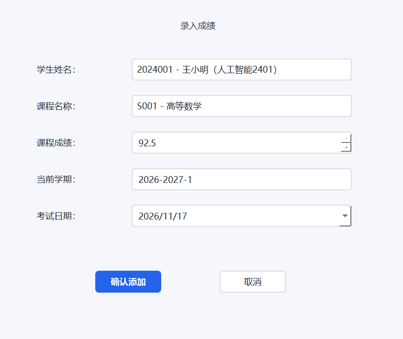

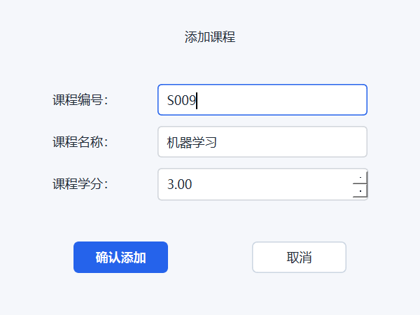

教师端的统计报表支持班级绩点排名、全部学生排名、单科班级排名、单科全体排名，并可导出 CSV 与打印。数据直接来自 `v_student_overview` 与 `v_student_grades`，保证应用与数据库统计口径一致。

### 6.2.3 学生端

图 6-9 为学生端：顶部显示姓名、学号、班级、状态，中部为 GPA、加权平均分、已修学分、班级/年级排名，底部为按学期筛选的成绩明细，不及格成绩红色显示。

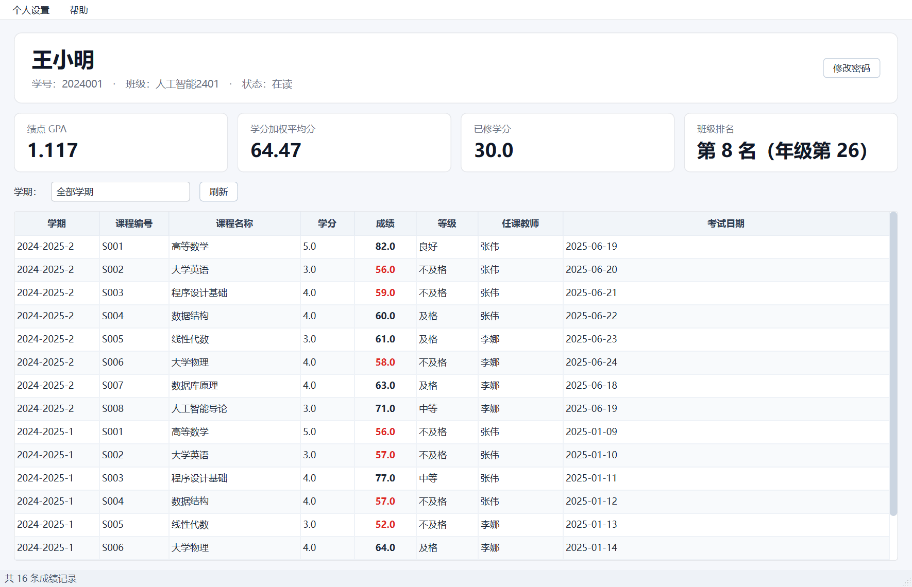

### 6.2.4 管理员端

图 6-10 为管理员端教师列表，显示教师 ID、姓名、账号、任课课程数、创建时间与状态；支持搜索、新建与删除教师。删除教师时课程变为未分配，历史成绩与审计日志保留。

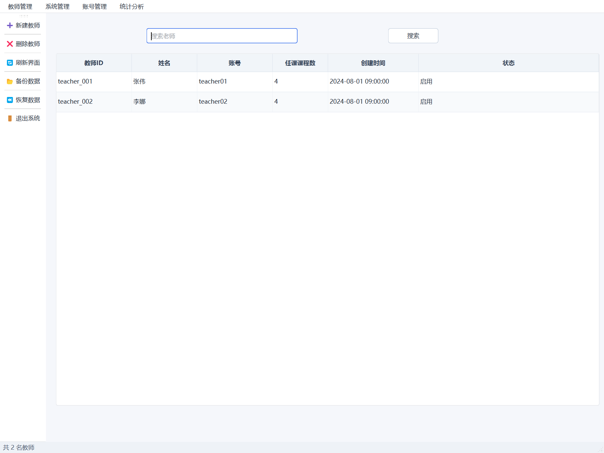

图 6-11 为数据看板：学生、教师、班级、课程、成绩计数与总体平均分，以及各班平均分柱状图和分数段分布图。图 6-12 为审计日志：显示成绩变更的时间、操作者、表、操作类型、记录键、旧值和新值。

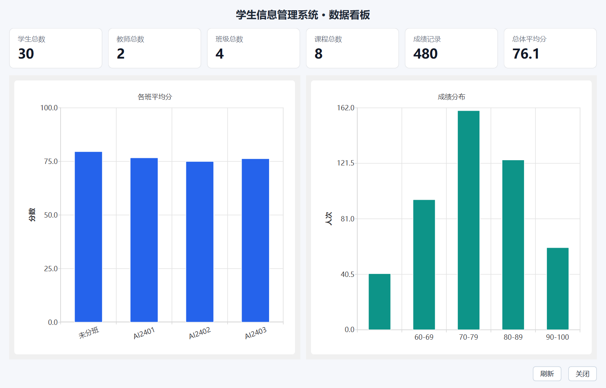

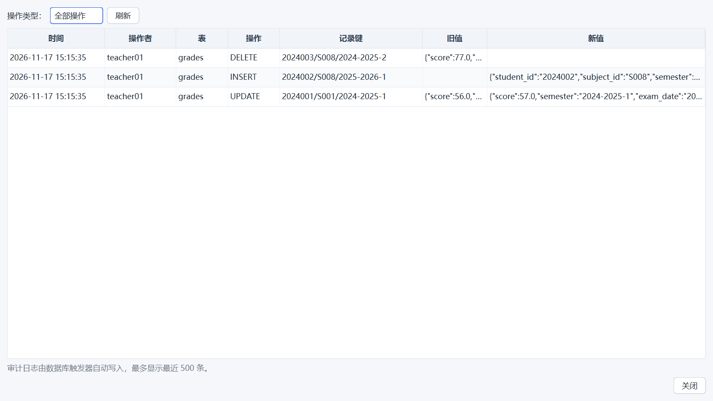

### 6.2.5 备份、恢复与账号设置

图 6-13 为数据库备份界面，显示当前库大小、数据量，默认备份路径与 `VACUUM INTO` 说明；图 6-14 为恢复界面，包含备份校验、备份统计、恢复说明和安全副本策略；图 6-15、图 6-16 为修改密码与修改密保界面，均要求验证原密码。

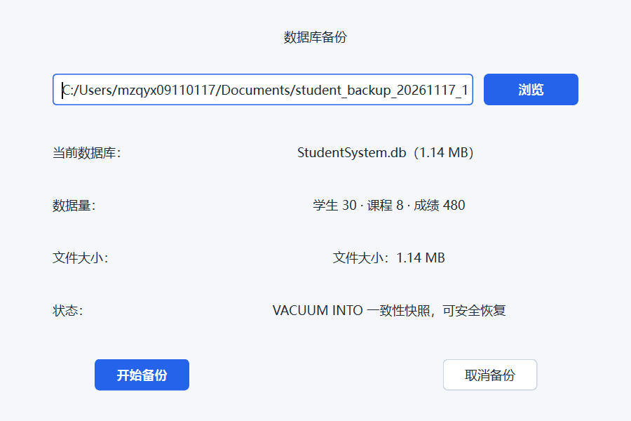

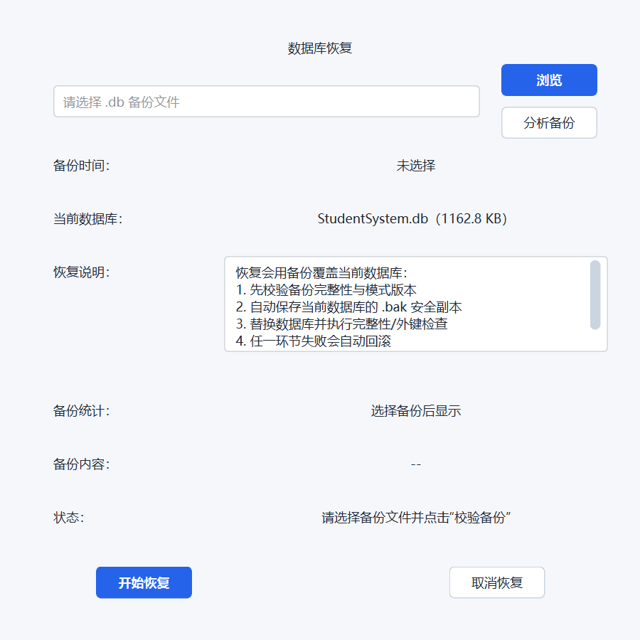

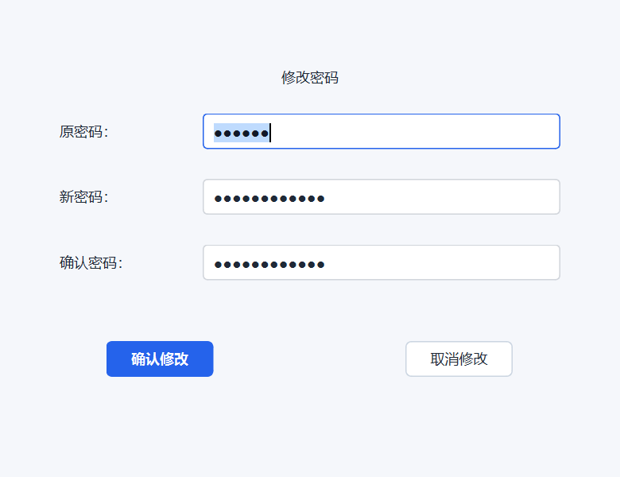

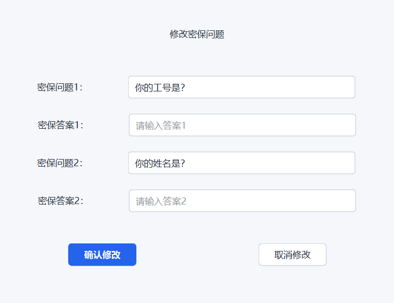

## 6.3 测试用例与结果

### 6.3.1 数据库层自动化测试

`tools/test_database.py` 在内存库中执行 `schema.sql + seed.sql`，共 36 项断言，全部通过。覆盖内容见表 6-1。

表 6-1 数据库测试用例（节选）

| 编号 | 用例 | 预期结果 | 实际结果 |
|---|---|---|---|
| D01 | 种子数据基础计数 | 4 班/30 学生/8 课程/480 成绩 | 通过 |
| D02 | 空班级持久化 | 数据科学2401 存在 | 通过 |
| D03 | 未分班学生 | 1 名学生 class_name 为 NULL | 通过 |
| D04 | 成绩 101 | 被 CHECK/触发器拒绝 | 通过 |
| D05 | 负分 | 被拒绝 | 通过 |
| D06 | 非法学期 2025-1 | 被拒绝 | 通过 |
| D07 | 重复成绩 | 被 UNIQUE 拒绝 | 通过 |
| D08 | UPSERT 更新 | 分数更新，审计记录旧值/新值 | 通过 |
| D09 | 删除学生 | 级联删除成绩，无孤儿记录 | 通过 |
| D10 | 删除有成绩课程 | 被外键 RESTRICT 拒绝 | 通过 |
| D11 | 删除无成绩课程 | 成功 | 通过 |
| D12 | 班级改名 | 学生 class_name 级联更新 | 通过 |
| D13 | 删除班级 | 学生转为 NULL | 通过 |
| D14 | 第二个管理员 | 被部分唯一索引拒绝 | 通过 |
| D15 | 删除最后管理员 | 被触发器拒绝 | 通过 |
| D16 | 修改最后管理员角色 | 被触发器拒绝 | 通过 |
| D17 | 视图行数/GPA/排名 | 符合预期 | 通过 |
| D18 | 事务回滚 | 无残留数据 | 通过 |
| D19 | 完整性与外键检查 | integrity_check=ok，无冲突 | 通过 |

### 6.3.2 应用程序自检

`StudentManagementSystem_Qt.exe --self-test` 在真实 Qt + SQLite 环境中执行 43 项断言，全部通过，覆盖：

- 管理员、教师、学生登录，错误密码与空密码拒绝；
- 学生账号开通、初始密码强制修改、改密后登录、注销账号；
- 旧版无盐哈希登录并自动升级；
- 密保问题修改、答案校验、错误答案拒绝；
- 成绩越界、非法学期、重复成绩拒绝；
- 审计触发器记录；
- 教师注册、重复管理员拒绝、教师删除；
- 删除学生级联删除成绩；
- `VACUUM INTO` 备份、备份校验、恢复、恢复后数据回滚、完整性与外键检查。

### 6.3.3 功能测试

表 6-2 功能测试（节选）

| 编号 | 功能 | 操作 | 结果 |
|---|---|---|---|
| F01 | 三角色登录 | 分别使用 admin、teacher01、2024001 登录 | 进入对应主窗口 |
| F02 | 登录失败锁定 | 连续输错 5 次 | 按钮锁定 30 秒 |
| F03 | 首次登录改密 | 新建学生账号登录 | 强制改密后才能进入 |
| F04 | 学生搜索 | 按学号/姓名/班级/电话搜索 | 结果正确，分页重置 |
| F05 | 添加学生 | 学号重复、年龄越界、班级为空 | 均给出中文提示 |
| F06 | 编辑学生 | 修改姓名/电话/班级 | 班级保持正确，不被重置 |
| F07 | 删除学生 | 有成绩的学生 | 提示成绩数量，级联删除 |
| F08 | 空班级 | 新增班级后重启 | 班级仍存在 |
| F09 | 班级改名 | 改名后查看学生 | 学生班级同步更新 |
| F10 | 删除班级 | 删除有学生班级 | 学生转为未分班 |
| F11 | 课程重名 | 同一教师添加同名课程 | 被拒绝并提示 |
| F12 | 成绩录入 | 录入 100 分 | 可正常保存 |
| F13 | 成绩覆盖 | 重复录入同一学生/课程/学期 | 提示确认后覆盖 |
| F14 | 成绩删除 | 在成绩管理中删除 | 列表刷新，审计新增 DELETE |
| F15 | 报表 | 班级绩点排名 | GPA 与排名正确，可导出/打印 |
| F16 | 备份恢复 | 备份→改数据→恢复 | 数据回到备份时点 |
| F17 | 学生端隔离 | 学生登录 | 只能看到本人成绩 |
| F18 | 审计日志 | 管理员查看 | 显示操作者与新旧值 |
| F19 | 数据看板 | 管理员打开 | 计数、柱状图、分布图正确 |
| F20 | 截图模式 | `--capture` | 16 张 PNG 全部生成 |

## 6.4 演示账号与操作说明

表 6-3 演示账号

| 角色 | 登录名 | 初始密码 | 说明 |
|---|---|---|---|
| 管理员 | admin | admin123 | 教师账号、看板、审计、备份恢复 |
| 教师 | teacher01 | 123456 | 张伟，课程 S001-S004 |
| 教师 | teacher02 | 123456 | 李娜，课程 S005-S008 |
| 学生 | 2024001 | 123456 | 王小明，人工智能2401 |

演示步骤建议：

1. 双击 `StudentManagementSystem_Qt.exe`，使用 teacher01 登录，浏览学生列表、按班级筛选、搜索“王小明”。
2. 添加一名学生，再编辑其班级，观察班级列表与表格刷新。
3. 进入“成绩管理”录入/修改成绩，打开管理员端“审计日志”查看触发器记录。
4. 打开“数据看板”查看统计图。
5. 管理员执行“备份数据”，修改一条成绩后执行“恢复数据”，验证数据回滚。
6. 使用 2024001 登录学生端，查看本人 GPA 与成绩。
7. 也可以在命令行执行 `--self-test` 查看 43 项自动化断言结果。

# 第7章 总结与展望

## 7.1 完成情况

本作品完成了从选题、需求分析、概念/逻辑/物理设计、数据库实施到应用开发和运行演示的完整流程。数据库层实现了规范的单库设计、外键与级联、CHECK/UNIQUE 约束、索引、5 个视图、8 个触发器、事务、审计、WAL 并发控制与一致性备份恢复；应用层实现了管理员、教师、学生三类角色的完整功能，修复了原版本的教师编号冲突、库路径依赖工作目录、外键未启用、空班级丢失、编辑学生班级被重置、GPA 计算错误、确认密码未校验、改密不验证原密码、成绩查看无排序、备份不一致等关键问题。

测试与演示结果表明系统运行稳定：36 项数据库测试、43 项应用自检全部通过，16 张运行截图覆盖三种角色和主要功能，20 万条成绩规模下索引使典型查询提升 4.1～545.8 倍。

## 7.2 收获与体会

（1）**数据库设计是应用质量的基础**。同一份需求，采用“每教师一库”还是“统一单库”，直接决定了能否进行跨班级统计、能否使用外键和事务。规范化设计让数据修改只有一处入口，减少了大量应用层补丁。

（2）**约束应尽量下沉到数据库**。UNIQUE、CHECK、外键、触发器在应用被绕过或并发写入时仍然有效；应用层校验更多是用户体验，数据库约束才是最后防线。

（3）**索引要按查询设计**。学生编号查询由唯一约束的自动索引覆盖，额外索引没有收益；而审计日志按时间排序、课程+学期统计则从针对性索引中获得几十到几百倍提升。

（4）**测试与可重复构建非常重要**。固定随机种子的演示数据、自动化数据库测试、应用自检和截图模式，使报告中的数字和图都来自真实运行结果，而不是手工拼凑。

## 7.3 不足与展望

（1）SQLite 是单机嵌入式数据库，适合桌面演示，但不支持多机并发和细粒度用户授权；后续可迁移到 MySQL/PostgreSQL，利用存储过程、事件、用户权限和主从复制。

（2）当前口令哈希为迭代 SHA-256，未使用内存硬算法；生产环境应改为 Argon2id 或 bcrypt，并增加登录审计与验证码。

（3）界面采用固定尺寸布局，未做响应式适配；后续可使用 Qt 布局管理器和模型/视图框架重构，支持高 DPI 和窗口缩放。

（4）功能上还可以扩展选课、考勤、奖学金、毕业审核、批量导入导出、图表钻取等模块。

# 参考文献

[1] 王珊, 萨师煊. 数据库系统概论（第 5 版）[M]. 北京: 高等教育出版社, 2014.

[2] SQLite Documentation. SQLite Version 3.51.2 [EB/OL]. 2025.

[3] SQLite Documentation. VACUUM INTO, UPSERT, Window Functions, Foreign Key Support [EB/OL].

[4] Qt Documentation. Qt 6.11: Qt SQL, Qt Widgets, Qt Charts, Qt PrintSupport [EB/OL].

[5] 萨师煊, 王珊. 数据库系统概论学习指导与习题解答[M]. 北京: 高等教育出版社, 2008.

# 附录A 数据库脚本（节选）

完整的 `schema.sql` 与 `seed.sql` 随源码提交，可直接用 `sqlite3` 执行。以下为模式脚本的目录结构与关键片段。

```sql
-- 1. 元数据与会话
CREATE TABLE schema_meta (...);
CREATE TABLE app_context (...);

-- 2. 用户、教师、班级、学生
CREATE TABLE users (...);
CREATE TABLE teachers (...);
CREATE TABLE classes (...);
CREATE TABLE students (...);

-- 3. 课程、成绩、审计
CREATE TABLE subjects (...);
CREATE TABLE grades (...);
CREATE TABLE audit_log (...);

-- 4. 索引
CREATE UNIQUE INDEX ux_one_admin ...;
CREATE INDEX idx_grades_subject_sem ...;

-- 5. 触发器
CREATE TRIGGER trg_grades_validate_ai ...;
CREATE TRIGGER trg_grades_audit_ai ...;
CREATE TRIGGER trg_grades_audit_au ...;
CREATE TRIGGER trg_grades_audit_ad ...;
CREATE TRIGGER trg_students_touch ...;
CREATE TRIGGER trg_last_admin_delete ...;
CREATE TRIGGER trg_last_admin_update ...;

-- 6. 视图
CREATE VIEW v_student_grades ...;
CREATE VIEW v_class_subject_stats ...;
CREATE VIEW v_student_overview ...;
CREATE VIEW v_teacher_workload ...;
CREATE VIEW v_audit_display ...;
```

# 附录B 项目文件清单

表 B-1 主要交付文件

| 路径 | 说明 |
|---|---|
| StudentManagementSystem_Qt.pro | qmake 工程文件 |
| *.cpp / *.h / *.ui | 应用源码与界面 |
| sql/schema.sql | 建表、索引、视图、触发器脚本 |
| sql/seed.sql | 演示数据脚本 |
| tools/gen_seed.py | 演示数据生成器（固定种子） |
| tools/test_database.py | 数据库自动化测试（36 项） |
| tools/benchmark_index.py | 索引性能测试 |
| tools/gen_diagrams.py | E-R/架构/流程/模块图生成 |
| tools/build_docx.py | 作品说明书 Word 生成 |
| selftest.cpp | 应用自检（43 项） |
| screenshottool.cpp | 自动截图 |
| resources/style.qss | 界面主题 |
| docs/作品说明书.docx | 本文档 |
| docs/screenshots/*.png | 16 张运行截图 |
| deploy/ | 可双击运行的 Release 部署目录 |

# 附录C 使用说明

（1）**直接运行**：解压提交包，进入 `演示程序` 目录，双击 `StudentManagementSystem_Qt.exe`；首次运行会在 `data/` 下创建数据库并写入演示数据。

（2）**登录演示**：管理员 `admin / admin123`，教师 `teacher01 / 123456`，学生 `2024001 / 123456`。

（3）**重新初始化演示数据**：关闭程序，删除 `data/StudentSystem.db` 及同目录的 `-wal`、`-shm` 文件，再次启动即可。

（4）**自动化测试**：在程序目录执行 `StudentManagementSystem_Qt.exe --self-test`，查看 `selftest.log`；数据库层测试执行 `python -I tools/test_database.py`。

（5）**生成截图**：执行 `StudentManagementSystem_Qt.exe --capture <目录>`，程序会在独立演示库上自动生成 16 张界面截图。

（6）**备份与恢复**：管理员端“数据操作”菜单 → 备份/恢复；备份文件为单个 `.db`，恢复前会自动保存 `.bak` 安全副本。
